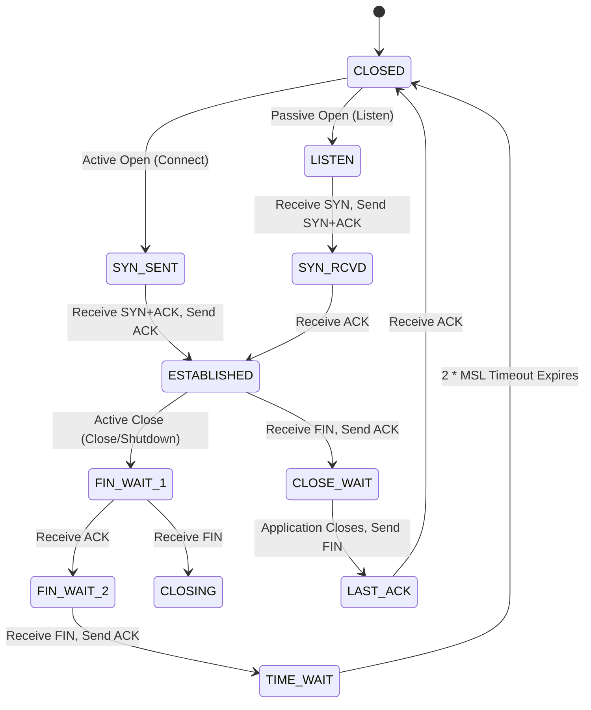

# TCP Internals: The Definitive Guide to How TCP Works

A complete architectural and operational guide explaining how TCP establishes connections, transfers data, handles disconnections, recovers from network failures, and resolves the famous "Two Generals' Problem".

---

## 📌 Table of Contents

1. [What is TCP? (The Basics)](#1-what-is-tcp-the-basics)
2. [The TCP Packet Header Anatomy](#2-the-tcp-packet-header-anatomy)
3. [Connection Establishment: 3-Way Handshake](#3-connection-establishment-3-way-handshake)
4. [Data Transmission, Flow Control & Reliability](#4-data-transmission-flow-control--reliability)
5. [Connection Teardown: 4-Way Handshake](#5-connection-teardown-4-way-handshake)
6. [The "Internet Drop" Dilemma (Half-Open / Ghost Connections)](#6-the-internet-drop-dilemma-half-open--ghost-connections)
7. [How Dead Connections are Detected](#7-how-dead-connections-are-detected)
   - [The `RST` (Reset) Packet](#the-rst-reset-packet)
   - [TCP Keep-Alive (`SO_KEEPALIVE`)](#tcp-keep-alive-so_keepalive)
   - [Application-Layer Heartbeats (Ping/Pong)](#application-layer-heartbeats-pingpong)
8. [The Two Generals' Problem & The Telephone Analogy](#8-the-two-generals-problem--the-telephone-analogy)
9. [TCP State Machine Reference](#9-tcp-state-machine-reference)
10. [RTT (Round Trip Time) & Dynamic Latency Adaptation](#10-rtt-round-trip-time--dynamic-latency-adaptation)
11. [RFC (Request for Comments) — The Internet's Rulebook](#11-rfc-request-for-comments--the-internets-rulebook)
12. [Interview Q&A Cheat Sheet](#12-interview-qa-cheat-sheet)

---

## 1. What is TCP? (The Basics)

**TCP (Transmission Control Protocol)** is a Layer 4 (Transport Layer) protocol that provides:

- **Connection-Oriented**: A dedicated logical connection is negotiated before any application data is transferred.
- **Reliable Delivery**: Every packet is acknowledged. Lost packets are automatically retransmitted.
- **In-Order Delivery**: Packets that arrive out of order (due to network routing) are reassembled into the exact sequence sent.
- **Full-Duplex**: Both Client and Server can transmit and receive data simultaneously over the same connection.
- **Byte-Stream Oriented**: TCP does not recognize application message boundaries (e.g., HTTP requests or JSON blobs). It treats data as a continuous stream of bytes.

---

## 2. The TCP Packet Header Anatomy

Every TCP segment carries a 20-byte to 60-byte header:

```text
 0                   1                   2                   3
 0 1 2 3 4 5 6 7 8 9 0 1 2 3 4 5 6 7 8 9 0 1 2 3 4 5 6 7 8 9 0 1
+-+-+-+-+-+-+-+-+-+-+-+-+-+-+-+-+-+-+-+-+-+-+-+-+-+-+-+-+-+-+-+-+
|          Source Port          |       Destination Port        |
+-+-+-+-+-+-+-+-+-+-+-+-+-+-+-+-+-+-+-+-+-+-+-+-+-+-+-+-+-+-+-+-+
|                        Sequence Number                        |
+-+-+-+-+-+-+-+-+-+-+-+-+-+-+-+-+-+-+-+-+-+-+-+-+-+-+-+-+-+-+-+-+
|                    Acknowledgment Number                      |
+-+-+-+-+-+-+-+-+-+-+-+-+-+-+-+-+-+-+-+-+-+-+-+-+-+-+-+-+-+-+-+-+
|  Data |           |U|A|P|R|S|F|                               |
| Offset| Reserved  |R|C|S|S|Y|I|            Window Size        |
|       |           |G|K|H|T|N|N|                               |
+-+-+-+-+-+-+-+-+-+-+-+-+-+-+-+-+-+-+-+-+-+-+-+-+-+-+-+-+-+-+-+-+
|           Checksum            |        Urgent Pointer         |
+-+-+-+-+-+-+-+-+-+-+-+-+-+-+-+-+-+-+-+-+-+-+-+-+-+-+-+-+-+-+-+-+
|                    Options (Variable 0-40 bytes)              |
+-+-+-+-+-+-+-+-+-+-+-+-+-+-+-+-+-+-+-+-+-+-+-+-+-+-+-+-+-+-+-+-+
```

### Key Control Flags (1 Bit Each):

- **`SYN` (Synchronize)**: Initiates a connection and synchronizes initial sequence numbers (ISN).
- **`ACK` (Acknowledgment)**: Confirms receipt of previously transmitted data or control flags.
- **`FIN` (Finish)**: Initiates a graceful connection shutdown (no more data to send from this side).
- **`RST` (Reset)**: Aborts a connection immediately due to an error, unmapped port, or ghost socket.
- **`PSH` (Push)**: Tells receiver's TCP stack to push buffered data immediately to the application without waiting for buffers to fill.
- **`URG` (Urgent)**: Marks data as out-of-band priority.

---

## 3. Connection Establishment: 3-Way Handshake

Before exchanging data, Client and Server synchronize using a **3-Way Handshake**:

```text
Client (Active)                               Server (Passive / LISTEN)
   |                                                     |
   | ----------- 1. SYN (seq=1000) --------------------> | [State: SYN_RCVD]
   |                                                     | Server allocates TCB buffer
   | <---------- 2. SYN-ACK (seq=5000, ack=1001) ------- |
   |                                                     |
[State: ESTABLISHED]                                     |
   | ----------- 3. ACK (ack=5001) --------------------> | [State: ESTABLISHED]
   |                                                     |
   | ========= CONNECTION OPEN: READY FOR DATA ========= |
```

1. **Step 1 (`SYN`)**: Client picks a random Initial Sequence Number (e.g., `seq=1000`) and sends `SYN` to Server. Client enters `SYN_SENT`.
2. **Step 2 (`SYN-ACK`)**: Server receives `SYN`, allocates connection buffers (Transmission Control Block - TCB), picks its own sequence number (e.g., `seq=5000`), acknowledges Client's sequence (`ack=1001`), and enters `SYN_RCVD`.
3. **Step 3 (`ACK`)**: Client acknowledges Server's sequence (`ack=5001`). Both sides are now in the `ESTABLISHED` state.

---

## 4. Data Transmission, Flow Control & Reliability

### A. Sequence & Acknowledgment Numbers

TCP assigns a sequence number to every byte transmitted:

- If Client sends 100 bytes starting at `seq=1001`, the packet covers bytes `1001` through `1100`.
- The Server replies with `ACK=1101` (_"I have received all bytes up to 1100, send me byte 1101 next"_).

### B. Flow Control: Sliding Window (`rwnd`)

What if the sender is faster than the receiver can process?

- The receiver advertises its available buffer space via the **Window Size** field in the TCP header.
- If the receiver's application buffer is full, it advertises `Window Size = 0` (**Zero Window**).
- The sender **pauses transmission** until the receiver processes data and sends a window update. This prevents buffer overflow.

### C. Retransmission Timeout (RTO)

If an ACK does not return within a calculated time window (Round Trip Time + variance), TCP retransmits the missing packet automatically.

---

## 5. Connection Teardown: 4-Way Handshake

Because TCP is **Full-Duplex**, closing a connection requires each side to close its half independently:

```text
Initiator (e.g., Server)                               Receiver (e.g., Client)
   |                                                              |
[State: FIN_WAIT_1]                                               |
   | --------------------- 1. FIN (seq=X) ----------------------> | [State: CLOSE_WAIT]
   |                                                              |
[State: FIN_WAIT_2]                                               |
   | <-------------------- 2. ACK (ack=X+1) --------------------- |
   |                                                              |
   |      (Half-Close: Receiver can still flush remaining data)   |
   |                                                              |
   |                                                              | [State: LAST_ACK]
   | <-------------------- 3. FIN (seq=Y) ----------------------- |
   |                                                              |
[State: TIME_WAIT]                                                |
   | --------------------- 4. ACK (ack=Y+1) --------------------> | [State: CLOSED]
   |                                                              |
   |  (Waits 2 * MSL ≈ 60s before fully closing)                  |
   |                                                              |
[State: CLOSED]                                                   |
```

### Why does the Initiator wait in `TIME_WAIT`?

1. **To reliably deliver the final ACK**: If Packet #4 (`ACK`) is lost in the network, the Receiver will retransmit its `FIN` (Packet #3). The Initiator must stay alive in `TIME_WAIT` to receive that retransmitted `FIN` and resend the `ACK`.
2. **To drain old duplicate packets**: Ensures all stray packets wandering in intermediate routers expire before a new socket binds to the same IP:Port.

---

## 6. The "Internet Drop" Dilemma (Half-Open / Ghost Connections)

### The Real-World Scenario:

1. Client connects to Server.
2. Server initiates close: sends `FIN` (Packet #1).
3. **At this exact instant, Client loses internet connectivity (cable unplugged / mobile tower dropped).**

### What Happens Behind the Scenes?

```text
Server                                       Client
  |                                            |
  | --- FIN (Packet #1) ---> [LOST IN TRANSIT] X  (Client is offline!)
  |                                            |
  | Retransmits FIN 3-5 times...               |
  | Timeout reached!                           |
  | Server destroys socket locally             |
(CLOSED)                                       |  Client still thinks:
                                               |  "Socket is ESTABLISHED"
```

1. **Server side**: The Server's `FIN` never reaches the Client. The Server retransmits `FIN` several times, reaches its OS retry timeout, and forcefully frees the socket. To the Server, the connection is **100% DEAD**.
2. **Client side**: The Client **never received the `FIN`**. Its operating system table still records this socket as `ESTABLISHED`.
3. **The Problem**: This is known as a **Half-Open Connection** (or **Ghost Connection**).

---

## 7. How Dead Connections are Detected

When the Client's internet comes back online, how does it discover the connection is dead?

### Case 1: Client Tries to Send Data $\rightarrow$ The `RST` Packet

If the Client application tries to write data:

```text
Client (Reconnected)                                Server
  |                                                    |
  | -------- Data Packet (Old Port & Sequence) ------> |
  |                                                    | Server checks table:
  |                                                    | "No such connection exists!"
  | <------- TCP RST (Reset) Packet ------------------ |
  |                                                    |
Client OS destroys socket immediately!
Go returns error: "read: connection reset by peer"
or "write: broken pipe"
```

- **The `RST` (Reset) packet** is TCP's panic button. It tells the remote side: _"You are talking to a port/connection that does not exist. Abort immediately."_

---

### Case 2: Client Remains Silent (Idle Socket)

If the Client only listens and never sends data, **it will never know the server is gone** unless one of the following mechanisms is active:

#### A. TCP Keep-Alive (`SO_KEEPALIVE`) — Kernel Level

The Linux kernel provides built-in dead connection probing:

```go
unix.SetsockoptInt(fd, unix.SOL_SOCKET, unix.SO_KEEPALIVE, 1)
```

- **How it works**: When a socket has been idle for `tcp_keepalive_time` (default: 7200 seconds / 2 hours), the kernel automatically sends an empty probe packet (`ACK` with `seq = current_seq - 1`).
- If no ACK is received after `tcp_keepalive_probes` (default: 9 attempts) spaced by `tcp_keepalive_intvl` (default: 75 seconds), the kernel closes the socket with `ETIMEDOUT`.
- **Kernel tuning**:
  ```bash
  sysctl -w net.ipv4.tcp_keepalive_time=60
  sysctl -w net.ipv4.tcp_keepalive_intvl=10
  sysctl -w net.ipv4.tcp_keepalive_probes=3
  ```

#### B. Application-Layer Heartbeats (Ping/Pong) — Production Standard

Operating system Keep-Alives take too long to detect dead peers. Therefore, production protocols (**WebSockets, gRPC, Redis, Kafka, WhatsApp**) implement application-level heartbeats:

```text
Client                                  Server
  |                                        |
  | ----- PING (every 15s) --------------> |
  | <---- PONG --------------------------- |
  |                                        |
  | ----- PING (every 15s) --------------> X (Server down / Network dead)
  |       (No response for 30s timeout)    |
  |                                        |
Client closes socket locally & shows "Disconnected"
```

---

## 8. The Two Generals' Problem & The Telephone Analogy

### The Telephone Analogy:

> _"When Person A says 'I am hanging up', and Person B says 'I am hanging up', neither can be 100% sure the other heard their final words before the line was disconnected."_

### The Two Generals' Problem in Computer Science:

Imagine two allied generals planning to attack a fortress. They must attack simultaneously to win. They can only communicate via messengers crossing enemy territory, who might be captured.

```text
General 1                                           General 2
   |                                                    |
   | ----- "Attack tomorrow at dawn" -----------------> |
   |       (Did General 2 receive this?)                |
   |                                                    |
   | <---- "Received! I will attack at dawn" ---------- |
   |       (Does General 2 know I received his ACK?)    |
   |                                                    |
   | ----- "ACK received! Confirmed" -----------------> |
   |       (Does General 1 know I got this ACK?)        |
   |                      ...                           |
   |           INFINITE ACKNOWLEDGMENT LOOP             |
```

### The Mathematical Proof:

It is mathematically impossible to guarantee 100% consensus between two parties over an unreliable medium using only acknowledgments.

### How TCP Pragmatically Resolves This:

TCP does not attempt infinite acknowledgments. Instead, it uses **Timeouts & States**:

1. When a side sends its final `ACK`, it enters **`TIME_WAIT`** for $2 \times \text{MSL}$ (~60s).
2. If no retransmitted `FIN` arrives within that window, it **assumes** the other party received the `ACK` and safely cleans up the connection.

---

## 9. TCP State Machine Reference



---

## 10. RTT (Round Trip Time) & Dynamic Latency Adaptation

### What is RTT?
**RTT (Round Trip Time)** is the total time (in milliseconds) it takes for a data packet to travel from the sender to the receiver **plus** the time it takes for the acknowledgment (`ACK`) or response to return to the sender:

$$\text{RTT} = T_{\text{outbound}} + T_{\text{inbound}}$$

When you run `ping google.com`, the `time=24.2 ms` displayed in your terminal is precisely the RTT.

### Why Does RTT Change Constantly? (Is RTT Fixed?)
**No, RTT is never fixed.** It dynamically fluctuates due to:
1. **Queuing Delay (Bufferbloat / Traffic Congestion)**: Intermediate routers hold incoming packets in memory queues during peak traffic. If a router is congested, packets wait in queue longer before transmission.
2. **Bandwidth Drops (Transmission Delay)**: When moving to a slower network (e.g. 5G to 3G), pushing packet bits onto the physical medium takes longer.
3. **BGP Rerouting (Propagation Delay)**: If an ISP reroutes traffic along an alternate path (e.g. due to fiber cuts), physical distance increases, increasing latency.
4. **Jitter**: The rapid millisecond-to-millisecond variation in RTT is called **Jitter**.

### How TCP Handles Dynamic RTT (Jacobson's Algorithm)
If RTT is constantly shifting, how does TCP know whether a missing ACK is caused by a lost packet or just network lag? Hardcoding a fixed timeout would either cause premature duplicate retransmissions or slow recovery.

TCP solves this by **dynamically adjusting its Retransmission Timeout (RTO)** using **Jacobson's Algorithm**:

1. **Measure Every Packet (`SampleRTT`)**:
   TCP times the exact round-trip for transmitted packets and their incoming ACKs.
2. **Compute an Exponential Moving Average (SRTT - Smoothed RTT)**:
   TCP does not overreact to a single spike. It maintains a running smoothed average:
   $$\text{SRTT} \leftarrow (1 - \alpha) \cdot \text{SRTT} + \alpha \cdot \text{SampleRTT} \quad (\text{typically } \alpha = 0.125)$$
3. **Compute RTT Variance (`RTTVAR` / Jitter)**:
   $$\text{RTTVAR} \leftarrow (1 - \beta) \cdot \text{RTTVAR} + \beta \cdot |\text{SRTT} - \text{SampleRTT}| \quad (\text{typically } \beta = 0.25)$$
4. **Dynamically Set RTO (Retransmission Timeout)**:
   $$\text{RTO} = \text{SRTT} + \max(G, 4 \times \text{RTTVAR})$$
   *(where $G$ is the clock granularity)*.

* **Result**: When your network is fast (RTT = 20ms), TCP resends lost packets after ~50ms. When your network slows down (RTT = 200ms), TCP raises its timeout to ~400ms automatically to prevent choking the network with redundant duplicates.

---

## 11. RFC (Request for Comments) — The Internet's Rulebook

### What is an RFC?
An **RFC (Request for Comments)** is the official, authoritative technical document published by the **IETF (Internet Engineering Task Force)** that defines the standards, protocols, and operational procedures of the global Internet.

### Why Such a Humble Name? (Historical Origin)
In 1969, during the early development of ARPANET (the precursor to the Internet), Steve Crocker and fellow young computer scientists began writing technical proposals.
* They wanted to avoid sounding authoritarian or dogmatic.
* They titled their working notes **"Request for Comments"** to invite constructive peer feedback and debate.
* The humble title stuck, and today every foundational Internet standard remains an "RFC".

### Core Rules of RFCs:
1. **Numbered and Immutable**: Once an RFC is assigned a number (e.g. RFC 793), it is **never edited or modified**. If changes are required, a new RFC is published that marks the older one as *Obsoleted* or *Updated*.
2. **Vendor Neutrality**: Any company (Google, Apple, Microsoft, Linux kernel) implementing TCP or HTTP must follow the exact rules defined in the corresponding RFC to ensure global interoperability.

### Essential RFCs Every Engineer Should Know:
* **RFC 793 / RFC 9293**: **TCP Specification** (defines the 3-way handshake, flags, state machine, and reliability algorithms).
* **RFC 9110 / RFC 7230**: **HTTP Semantics and Protocols** (HTTP/1.1 and modern HTTP standards).
* **RFC 1918**: **Private IPv4 Address Spaces** (allocates `10.0.0.0/8`, `172.16.0.0/12`, and `192.168.0.0/16` for internal private networks).
* **RFC 6455**: **The WebSocket Protocol** (full-duplex client-server web communications).
* **RFC 1149 (Humorous)**: *"A Standard for the Transmission of IP Datagrams on Avian Carriers"* — An April Fools' Day RFC specifying how to route IP packets using homing pigeons.

---

## 12. Interview Q&A Cheat Sheet

| Question | Crisp Interview Answer |
| :--- | :--- |
| **What is RTT (Round Trip Time)?** | The total latency for a packet to reach its destination plus the time for its ACK to return to the sender. |
| **Is RTT fixed? Why does it change?** | No, RTT is dynamic. It changes constantly due to queuing delays (bufferbloat), bandwidth fluctuations, and routing path changes. |
| **How does TCP calculate RTO?** | TCP uses Jacobson's algorithm to compute Smoothed RTT (SRTT) and RTT Variance (RTTVAR), dynamically calculating $\text{RTO} = \text{SRTT} + 4 \times \text{RTTVAR}$. |
| **What is an RFC?** | An official technical publication by the IETF that defines standard protocols and specifications for the Internet (e.g., RFC 9293 for TCP). |
| **What is a Half-Open Connection?** | A state where one side has closed or crashed, but the remote side still believes the connection is valid and `ESTABLISHED`. |
| **What triggers a TCP `RST` packet?** | Arrival of a packet for a port or sequence number that does not match any active TCP socket in the OS table. |
| **Why is `TIME_WAIT` 2 MSL?** | Maximum Segment Lifetime (MSL) is the max time a packet can survive in the network. $2 \times \text{MSL}$ guarantees both the final ACK and any retransmitted FIN have cleared the network. |
| **Why is 3-Way Handshake used instead of 2-Way?** | Both sides must independently establish and acknowledge their starting sequence numbers to prevent delayed duplicate packets from causing phantom connections. |
| **Difference between `broken pipe` and `connection reset by peer`?** | `connection reset by peer`: You attempted to read from or wrote to a socket after the remote peer closed it with `RST`. `broken pipe`: You wrote data to a socket after receiving a `RST`. |
| **How do you detect a dead TCP connection without sending data?** | Via OS-level `SO_KEEPALIVE` probes, or application-level periodic Ping/Pong heartbeats with a timeout. |
